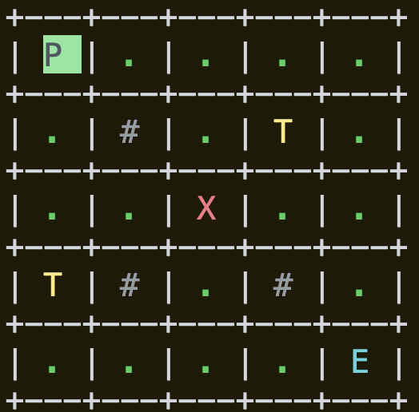
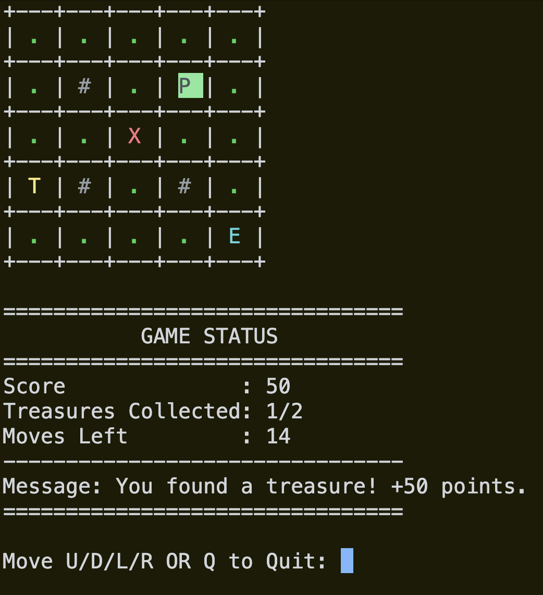
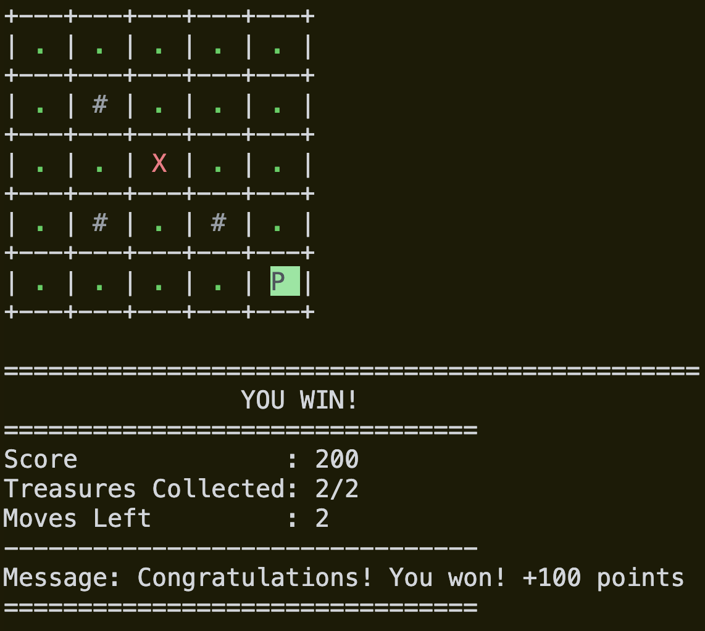

# Treasure Island Game in C

A simple console-based adventure game built in C. Navigate a 5×5 island, collect treasures, avoid traps, and reach the exit before running out of moves.

## Screenshots

### 1. Game Map and Status

Shows the island grid, player position, score, collected treasures, remaining moves, and latest game message.



### 2. Collecting Treasures

Collect treasures to increase your score and progress toward completing the game.



### 3. Winning the Game

Collect both treasures and reach the exit to win the game and receive a bonus.



## Game Symbols

| Symbol | Meaning    |
| ------ | ---------- |
| `P`    | Player     |
| `.`    | Empty land |
| `#`    | Wall       |
| `T`    | Treasure   |
| `X`    | Trap       |
| `E`    | Exit       |

## How to Play

* `U` — Move up
* `D` — Move down
* `L` — Move left
* `R` — Move right
* `Q` — Quit the game

Commands are case-insensitive, so you can use uppercase or lowercase letters.

## Steps to Complete This Project

### Step 1: Create the Island Map Using a 2D Character Array

Create a 5×5 character array to represent the island.

The map contains empty land, walls, treasures, traps, and an exit.

### Step 2: Display the Map

Display the island map in the terminal using nested loops.

### Step 3: Add the Player

* Place the player at the starting position.
* Represent the player using `P`.
* Highlight the player's position.

### Step 4: Read Movement Commands

Allow the player to enter `U`, `D`, `L`, or `R` to move.

Use `Q` to quit the game.

### Step 5: Move the Player Safely

* Calculate the player's next position.
* Prevent the player from leaving the island.
* Prevent the player from moving through walls.
* Reject invalid movement commands.

### Step 6: Collect Treasures and Increase the Score

* `T`: Collect a treasure.
* Each treasure awards 50 points.
* Increase the collected treasure count.
* Replace a collected treasure with empty land so it cannot be collected twice.

### Step 7: Add Traps and Lose Points

When the player moves onto a trap:

* The player loses 20 points.
* The score cannot go below zero.
* A message informs the player about the trap.
* The player can continue playing.

### Step 8: Reach the Exit and Win the Game

The player must collect both treasures before reaching the exit.

* `T`: Collect a treasure and earn 50 points.
* `E`: Exit the island.
* If the player reaches `E` without collecting both treasures, the move is rejected.
* If both treasures are collected, reaching `E` wins the game.
* Winning awards an additional 100 points.

### Step 9: Limit the Player to 20 Valid Moves

The player has a maximum of 20 valid moves to collect both treasures and reach the exit.

* A valid move decreases the remaining moves by one.
* Hitting a wall does not consume a move.
* Trying to leave the island does not consume a move.
* Entering an invalid command does not consume a move.
* The game ends when the player runs out of moves.

### Step 10: Fix the Game Ending Logic

* Use the `toupper()` function from `<ctype.h>` to handle uppercase and lowercase movement commands.
* Track whether the player has won or lost.
* Display the appropriate final result.
* Display the final score, collected treasures, and remaining moves.

### Step 11: Make the Output Colorful and Fun

* Add colors for the different map symbols using ANSI escape codes.
* Display the island with a grid system.
* Highlight the player's position.
* Clear and redraw the terminal after each turn to show the updated map.

### Step 12: Improve the Game Status Display

Keep the important information together below the map.

The status section displays:

* Current score
* Treasures collected
* Moves remaining
* Latest game message

Messages about movement, walls, boundaries, treasures, and traps appear in a consistent location.

### Step 13: Display the Final Game Results

At the end of the game:

* Display the final island map.
* Show whether the player won or lost.
* Display the final score.
* Display the number of treasures collected.
* Display the remaining moves.
* Show the final game message.

## Scoring System

| Action                                         |     Points |
| ---------------------------------------------- | ---------: |
| Collect a treasure                             |        +50 |
| Step on a trap                                 |        -20 |
| Reach the exit after collecting both treasures | +100 bonus |

The score cannot go below zero.

## Concepts Practiced

This project helps beginners practice:

* Variables and data types
* Two-dimensional arrays
* Nested loops
* Conditional statements
* `switch` statements
* User input with `scanf()`
* Character handling with `toupper()`
* Array indexing and boundary validation
* Game state management
* Basic scoring systems
* ANSI terminal colors
* Step-by-step problem solving in C

## Requirements

* A C compiler, such as GCC or Clang
* A terminal that supports ANSI escape codes for colored output

## Compile and Run

Save the source code as `main.c`.

Compile:

```bash
gcc main.c -o treasure_island
```

Run on macOS or Linux:

```bash
./treasure_island
```

## Project Structure

```text
treasure-island/
├── main.c
├── README.md
└── screenshots/
    ├── game-map.png
    ├── collecting-treasure.png
    └── game-win.png
```

## Future Improvements

Possible extensions for this project include:

* Add random treasure and trap positions.
* Add multiple difficulty levels.
* Add a high-score system.
* Allow the player to restart the game.
* Add sound effects or more visual feedback.

---

**Project:** Treasure Island Game
**Language:** C
**Level:** Beginner
**Purpose:** Practice fundamental C programming concepts through a small interactive game.
